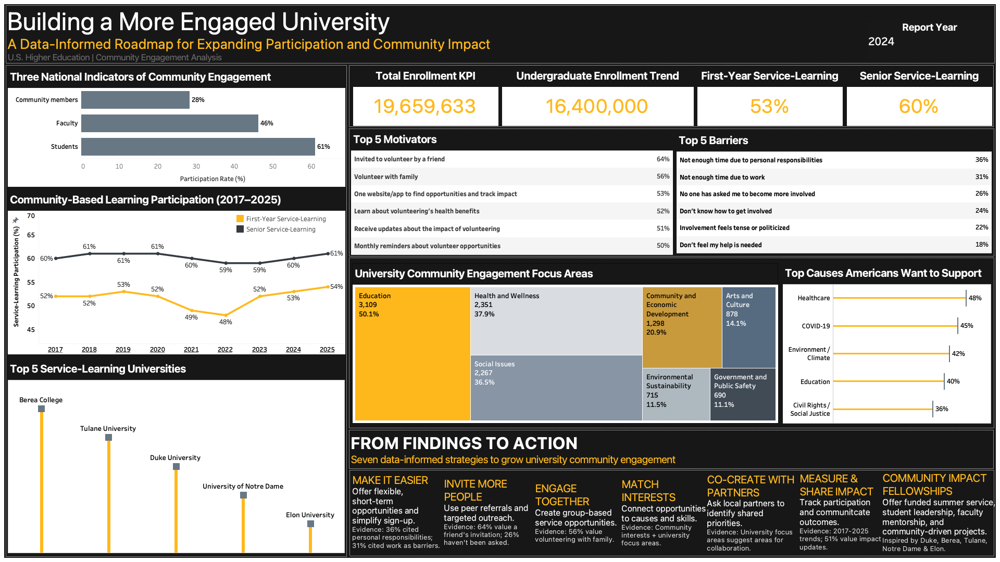
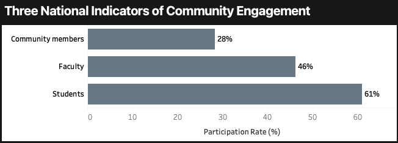

# university-community-engagement-tableau
This project uses Tableau to analyze community engagement and service-learning trends across U.S. universities. It explores participation patterns, volunteering motivations, common barriers, and ways universities can encourage greater involvement.
## Tableau Dashboard

The dashboard brings together national higher education data, service-learning trends, volunteering motivations, and barriers to participation. It also outlines approaches universities can consider to increase community engagement.

  

## Key Findings & Visualizations

### 1. Three National Indicators of Community Engagement

This chart looks at community engagement from three perspectives: students, faculty, and community members.

- **Students (61%):** A student engagement indicator drawn from NSSE data.
- **Faculty (46%):** A faculty engagement indicator based on HERI research.
- **Community members (28%):** The national formal volunteering rate reported by AmeriCorps and the U.S. Census Bureau for 2023.

  

**Key Finding:** Community engagement can be examined across students, faculty, and the wider public. These figures come from different studies, populations, and reporting periods, so they provide context rather than a direct comparison of participation rates.

**Sources:**
- [National Survey of Student Engagement (NSSE) — 2024 Annual Results](https://nsse.indiana.edu/research/annual-results/2024/index.html)
- [Higher Education Research Institute (HERI) — The American College Teacher](https://www.heri.ucla.edu/PDFs/pubs/FAC/Norms/Monographs/TheAmericanCollegeTeacher2004To2005.pdf)
- [AmeriCorps — Volunteering and Civic Life in America](https://americorps.gov/sites/default/files/document/CEV2023_HeadlineReport_11052024_final_508.pdf)
